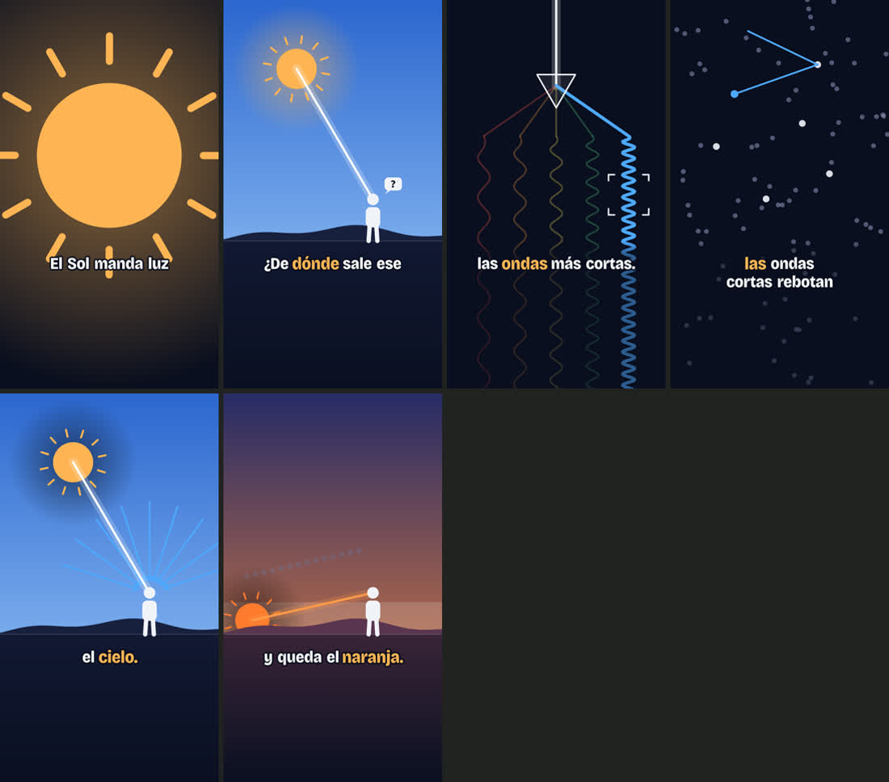
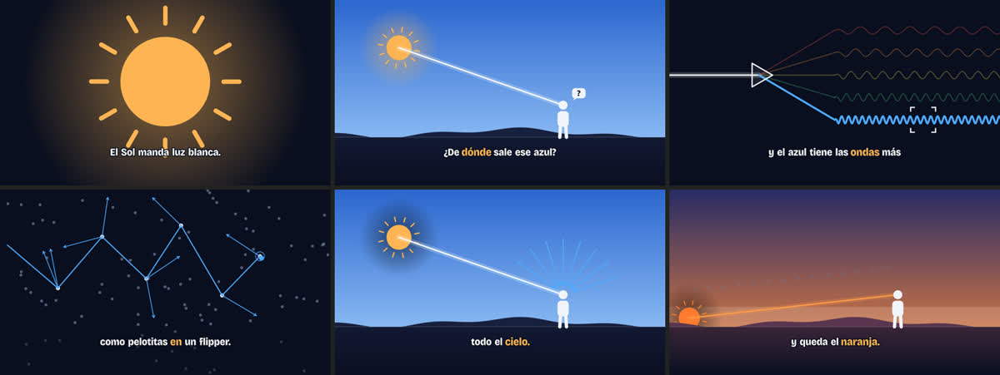

# Explainer: videos explicativos animados con Claude

Un skill para Claude. Convierte un tema en un video explicativo animado. Claude investiga, escribe el guion, dibuja una escena por bloque y la sincroniza con la voz.





## Qué hace

- Te pregunta formato, voz, estilo visual, duración y tono. Guarda las respuestas para la próxima vez.
- Investiga el tema y escribe el guion. Te muestra un storyboard antes de animar.
- Construye una página HTML que se reproduce sola: escenas animadas, subtítulos tipo karaoke y modo grabación.
- Exporta un MP4 en 1080 p, con subtítulos y sin subtítulos.
- Sincroniza la animación con tu voz grabada, palabra por palabra.

## Instalación

### Claude Code (terminal, app de escritorio o IDE)

En macOS o Linux:

```bash
git clone https://github.com/alandaitch/explainer-skill.git ~/.claude/skills/explainer
```

En Windows (PowerShell):

```powershell
git clone https://github.com/alandaitch/explainer-skill.git "$env:USERPROFILE\.claude\skills\explainer"
```

Abrí una sesión nueva y pedí un explainer.

### claude.ai (web o app)

1. Descargá `explainer.zip` desde [Releases](https://github.com/alandaitch/explainer-skill/releases/latest).
2. Activá la ejecución de código: Settings → Capabilities → Code execution and file creation.
3. Andá a Customize → Skills, tocá "+" y elegí "Upload a skill".
4. Subí el ZIP.

La ruta del menú puede cambiar según tu plan. Si no la encontrás, buscá "Skills" en la configuración.

### Exportar MP4 (opcional, solo Claude Code)

Necesitás Node 18 o más nuevo, ffmpeg y Playwright. Instalalos una vez:

```bash
cd ~/.claude/skills/explainer/scripts && npm install && npx playwright install chromium
```

Para ffmpeg: `brew install ffmpeg` en macOS, `winget install ffmpeg` en Windows o `sudo apt install ffmpeg` en Linux.

Sin estas herramientas, el skill igual arma el explainer. Lo grabás con el modo grabación y cualquier grabador de pantalla.

## Cómo se usa

Pedidos de ejemplo:

- "Haceme un explainer de por qué el Concorde dejó de volar."
- "Explainer horizontal para mi clase de fotosíntesis, 2 minutos, estilo pizarra."
- "Convertí esta nota en un reel animado: [link]."
- "Explicá cómo funciona mi producto en 45 segundos, con mis colores: #0F172A, #F8FAFC y #22C55E."
- "Ya grabé el audio. Armá el explainer sincronizado con mi voz."

La primera vez, Claude te hace estas preguntas:

| Pregunta | Opciones |
|---|---|
| Formato | Vertical 9:16 · Horizontal 16:9 · Cuadrado 1:1 · Feed 4:5 |
| Voz | La grabo yo después · Ya tengo el audio · Sin voz |
| Estilo | Noche · Papel · Pizarra · Plano color · Plano técnico · Tu marca |
| Duración | 30–45 s · 60–90 s · 2–3 min |
| Tono | Cercano · Neutro · Formal · Imitá un texto mío |
| Subtítulos | Karaoke · Simples · Sin subtítulos |

Después te muestra el guion y el storyboard. Con tu OK, construye la animación.

### Controles del explainer

- Tocá a la derecha para avanzar, a la izquierda para volver y al centro para pausar.
- **Modo grabación:** oculta los controles y arranca de cero.
- **S:** muestra u oculta los subtítulos. **H:** sale del modo grabación. **R:** reinicia.
- `?formato=16:9` en la URL previsualiza otro formato.

## Qué hay adentro

```
explainer/
├── SKILL.md                     instrucciones para Claude
├── assets/
│   ├── plantilla.html           motor y ejemplo de 4 escenas
│   └── ejemplos/                un explainer terminado de 70 s
├── references/
│   ├── formatos.md              zonas del cuadro y composición
│   ├── estilos.md               paletas, tipografías y tono
│   ├── escenas.md               patrones visuales e íconos
│   ├── movimiento.md            números de animación y laboratorio
│   └── audio.md                 sincronía con voz grabada
└── scripts/
    ├── simular.cjs              prueba la reproducción sin navegador
    ├── render.mjs               fotos, hoja de contacto y MP4
    └── palabras.mjs             tiempos por palabra desde Whisper
```

## Cómo funciona por dentro

- Cada explainer es un solo archivo HTML con un lienzo canvas.
- Cada cuadro es una función pura del tiempo. Por eso el MP4 sale idéntico a lo que ves.
- Cada evento visual se ancla a una palabra del guion. Si cambia la voz, la animación la sigue.
- Claude revisa su trabajo con fotos de cada escena antes de entregarlo.

## Créditos

Creado por [Alan Daitch](https://alandaitch.com). La idea de dirigir la animación con números en lugar de adjetivos sale de "Opus 5.5 Motion Lab", de Florence ([@flxrnc](https://x.com/flxrnc)).

## Licencia

MIT.

---

## English

A Claude skill that turns any topic into an animated explainer video. Claude asks about format, voice, visual style, length and tone, writes the script, storyboards it, and builds a self-playing HTML page with synced captions, a recording mode and frame-exact MP4 export. Works in 9:16, 16:9, 1:1 and 4:5. The instructions are in Spanish, but the skill writes scripts in any language.

Install for Claude Code:

```bash
git clone https://github.com/alandaitch/explainer-skill.git ~/.claude/skills/explainer
```

For claude.ai, download `explainer.zip` from Releases and upload it in Customize → Skills.
